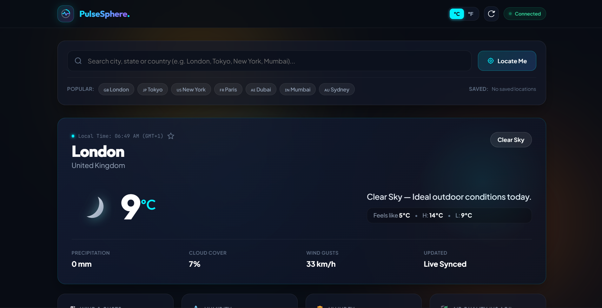
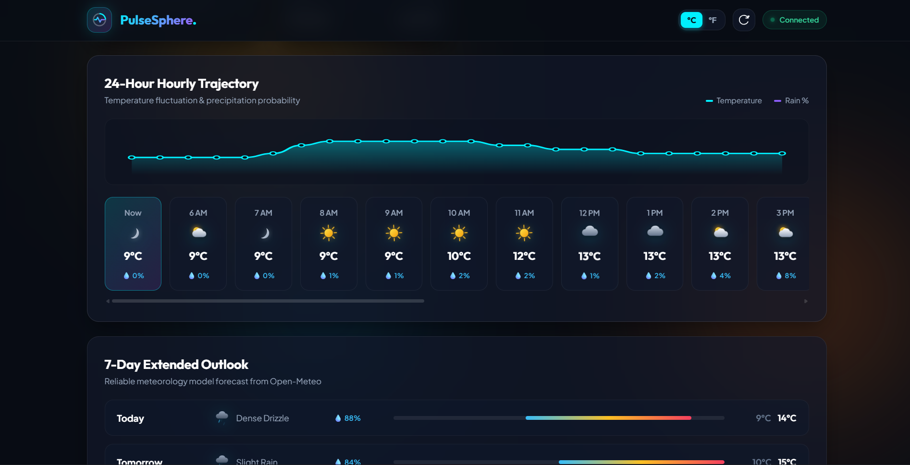
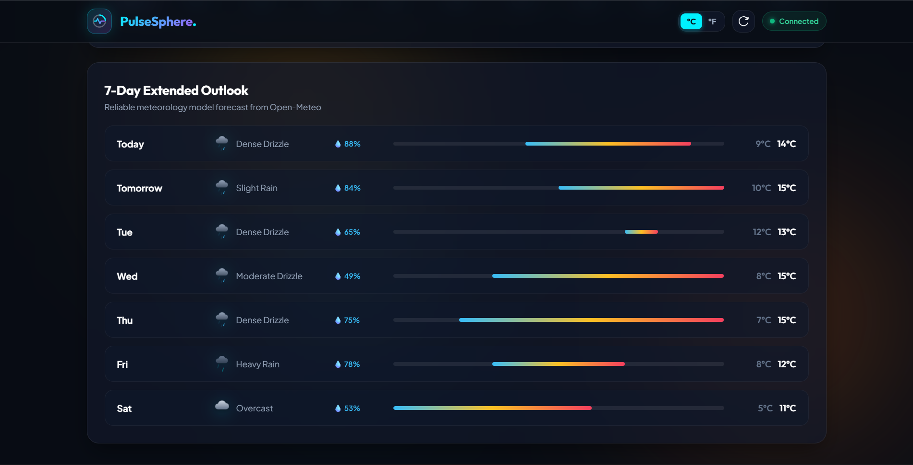
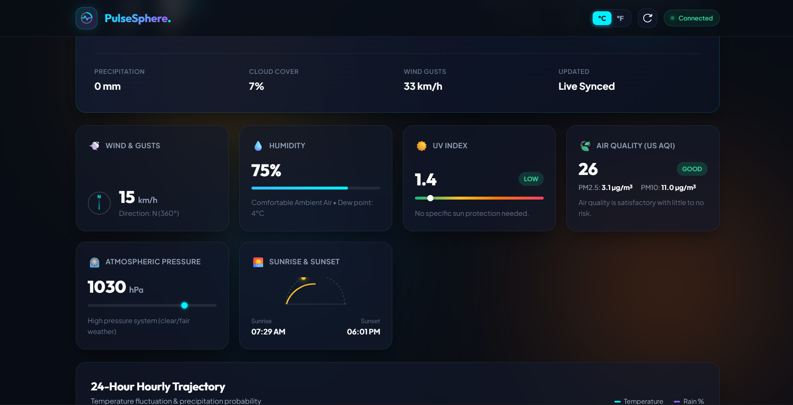

# PulseSphere — Real-Time Weather & Atmosphere Intelligence Hub
### Elite Tech Internship — Task 1: API Integration Project




---

## 📸 UI & Feature Showcase

| **Main Dashboard & Overview** | **24-Hour Hourly Trajectory** |
| :---: | :---: |
|  |  |
| *Live weather metrics, dynamic atmospheric backdrop, feels like, daily high/low* | *Hourly temperature trajectory, condition indicators, precipitation probability* |

| **7-Day Extended Outlook** | **Atmospheric Gauges & Environmental Intelligence** |
| :---: | :---: |
|  |  |
| *Visual weekly min/max temperature distribution bars & weather conditions* | *Animated compass dial, humidity, UV index, US AQI (PM2.5/PM10), pressure & sun arc* |

---

## 📌 Task Overview

* **Task ID**: Task 1 — API Integration
* **Objective**: Develop a modern, responsive web application that fetches and dynamically displays live data from public APIs (e.g., Weather).
* **Deliverable**: A responsive, production-ready webpage with API data dynamically loaded, processed, and presented with rich visual aesthetics and error handling.
* **Organization**: Elite Tech Intern Program

---

## 🌟 Key Application Features

### 1. 🌦️ Meteorological & Environmental Intelligence (Open-Meteo API)
- **Live Atmosphere Metrics**: Instant reading of current temperature, "feels like" index, daily high/low range, precipitation volume, cloud cover, and wind gusts.
- **Dynamic Adaptive Background**: Ambient cosmic glow orbs that smoothly morph color palettes based on weather conditions (Sunny Amber, Rainy Cyan, Storm Indigo, Snowy Blue).
- **Custom Animated Vector Weather Icons**: Native, crisp SVG icons with animated sun rays, drifting clouds, and falling precipitation.
- **6 Key Atmospheric Gauges**:
  1. *Wind & Compass*: Speed, gusts, and an animated compass dial rotating to exact wind direction degrees.
  2. *Humidity & Dew Point*: Dynamic progress track and calculated dew point comfort assessment.
  3. *UV Index Gauge*: Peak UV intensity with graduated health risk indicators (Low, Moderate, High, Extreme).
  4. *US Air Quality Index (AQI)*: Real-time AQI with particulate breakdown (PM2.5, PM10) and health recommendations.
  5. *Barometric Pressure*: Ambient pressure with needle gauge and meteorological trend analysis.
  6. *Sun Schedule*: Live sunrise and sunset times with dynamic daylight progress arc.
- **24-Hour Hourly Trajectory & Interactive SVG Curve**: Horizontal carousel showing temperature and rain probability alongside a smooth bezier gradient area chart.
- **7-Day Extended Outlook**: Visual temperature distribution bars indicating weekly min/max temperature shifts.

### 2. 🔍 Smart Search & Location Tools
- **Live Geocoding Autocomplete**: Real-time dropdown suggestions with administrative regions, coordinates, and debounced queries.
- **GPS "Locate Me"**: HTML5 Geolocation with reverse geocoding to detect your exact city.
- **Saved Favorites**: One-click bookmarking (★) persisted in browser `localStorage`.
- **Metric / Imperial Unit Switcher**: Instant switching between `°C / km/h` and `°F / mph` with recalculation across all views.

### 3. ⚡ Reliability & Offline Resilience
- **Network Status Toast**: Detects offline status and informs the user while serving cached state.
- **Shimmer Skeletons**: Polished placeholder loading states during API network round-trips.

---

## 🛠️ Public APIs Integrated

| API Service | Endpoint / Function | Authentication |
| :--- | :--- | :--- |
| **Open-Meteo Forecast API** | `https://api.open-meteo.com/v1/forecast` | Free / No API Key required |
| **Open-Meteo Air Quality API** | `https://air-quality-api.open-meteo.com/v1/air-quality` | Free / No API Key required |
| **Open-Meteo Geocoding API** | `https://geocoding-api.open-meteo.com/v1/search` | Free / No API Key required |

---

## 📁 Project Architecture

```text
EliteTech Projects/
├── 24hr.png         # 24-Hour forecast & temperature curve preview
├── 7dayextend.png   # 7-Day extended outlook preview
├── Info.png         # Atmospheric gauges & AQI preview
├── MainPage.png     # Full dashboard main page preview
├── index.html       # Semantic HTML5 document with accessibility & SEO tags
├── style.css        # Custom Glassmorphic design system, CSS variables & animations
├── app.js           # ES6+ modular controllers (WeatherService, UIController)
└── README.md        # Comprehensive internship deliverable documentation
```

---

## 🚀 How to Run Locally

Because PulseSphere is crafted with standard Vanilla Web Technologies and zero npm build dependencies, you can run it immediately on any machine:

### Option 1: Direct Browser Launch
Simply double-click [`index.html`](file:///c:/Users/hp/Desktop/EliteTech%20Projects/index.html) to open it in Google Chrome, Microsoft Edge, Firefox, or Safari.

### Option 2: Using Python HTTP Server (Recommended)
```bash
# Navigate to the project directory
cd "c:\Users\hp\Desktop\EliteTech Projects"

# Start a local static server
python -m http.server 8080
```
Then visit **`http://localhost:8080`** in your browser.

### Option 3: Using Node.js (npx serve)
```bash
npx serve .
```

---

## 🎨 Design Philosophy & Architecture

- **Aesthetic**: Deep obsidian dark mode (`#080c14`) paired with electric cyan (`#00f0ff`) and radiant violet (`#a855f7`) accents.
- **Performance**: Zero external UI framework overhead (React/Vue/Tailwind), loading in under 200ms.
- **Responsive**: Fluid CSS Grid and Flexbox layouts accommodating mobile devices (320px+), tablets, and 4K ultra-wide monitors.
- **Accessibility**: Semantic headings (`<h1>` to `<h3>`), descriptive ARIA roles, high color contrast ratios conforming to WCAG 2.1 AA.

---

**Developed for**: Elite Tech Internship Evaluation  
**Status**: Completed & Verified ✅

